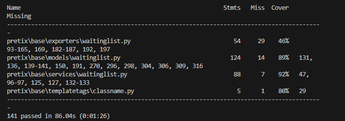

# Análise dos Testes Existentes (Pessoa 2)

> **Escopo:** Seção **Análise** referente à entrega da Pessoa 2 conforme o guia *T3 V&V – Guia passo a passo do grupo (Pretix)* (Partes 1 a 4). A montagem final do relatório em PDF único com o anexo de IA (Parte 5) será feita após a entrega das seções das Pessoas 1, 3, 4 e 5.

---

## 1. Levantamento quantitativo dos testes existentes

A contagem das funções de teste definidas com `def test_` (síncronas e `async def test_`) em `src/tests/` totaliza **3.780 funções de teste** (3.778 distribuídas nas subpastas e 2 nos arquivos na raiz de `tests/`: `test_crashing.py` e `test_startup.py`). Considerando cada combinação gerada por testes parametrizados, a coleta completa pelo `pytest` (`python -m pytest tests --co -q`) registra **6.133 casos de teste**.

| Pasta | Funções `def test_` | Observação |
|---|---:|---|
| `tests/base/` | 955 | Modelos, serviços e regras de negócio centrais |
| `tests/api/` | 952 | Endpoints da API REST |
| `tests/presale/` | 843 | Páginas públicas de compra e fluxo do cliente |
| `tests/control/` | 652 | Painel administrativo do organizador |
| `tests/plugins/` | 240 | Plugins nativos (ex.: `banktransfer`, `paypal2`, `stripe`, `sendmail`, `badges`, `autocheckin`, `ticketoutputpdf`) |
| `tests/multidomain/` | 63 | Roteamento e middlewares de múltiplos domínios |
| `tests/helpers/` | 48 | Funções utilitárias (datas, formatação, JSON, URLs) |
| `tests/concurrency_tests/` | 15 | Concorrência e bloqueio de compras simultâneas |
| `tests/e2e/` | 9 | Testes de sistema no navegador com Playwright |
| `tests/doc/` | 1 | Validação de documentação da API |
| `tests/*.py` (raiz) | 2 | `test_crashing.py` e `test_startup.py` |
| **Total** | **3.780** | **6.133 casos coletados via `pytest tests --co -q`** |

Observa-se forte concentração de testes nas camadas `base`, `api`, `presale` e `control` (que somam 3.402 funções, cerca de 90% do total) e um número muito reduzido de testes de sistema (`tests/e2e/`, apenas 9 funções), todos voltados ao widget de compra.

---

## 2. Classificação por tipo de teste

Com base na inspeção de arquivos representativos de cada diretório em `src/tests/`, os testes existentes classificam-se da seguinte forma segundo a nomenclatura da disciplina:

| Pasta | O que testa | Tipo de teste | Exemplos inspecionados |
|---|---|---|---|
| `tests/base` | Modelos e regras de negócio (preços, descontos, pedidos, lista de espera) | Maioria unitário, com banco | `tests/base/test_waitinglist.py` |
| `tests/presale` | Páginas de compra do cliente, pelo cliente de testes do Django (`self.client` + `BeautifulSoup`) | Integração | `tests/presale/test_event.py` |
| `tests/control` | Painel administrativo do organizador (criação/gestão de eventos, equipes, permissões) | Integração | `tests/control/test_events.py` |
| `tests/api` | API REST (autenticação, permissões por time, endpoints de recursos) | Integração (contrato da API) | `tests/api/test_auth.py` |
| `tests/concurrency_tests` | Compras simultâneas e locking de carrinho/pedido (requer PostgreSQL no CI) | Integração / concorrência | `tests/concurrency_tests/test_order_creation_locking.py` |
| `tests/e2e` | Widget de compra no navegador real com Playwright | Sistema | `tests/e2e/test_widget_button.py` |

As pastas auxiliares complementam esse conjunto: `tests/helpers` contém testes unitários puros (por exemplo, `tests/helpers/test_daterange.py` validando formatação de datas sem acesso a banco), enquanto `tests/plugins` (ex.: `tests/plugins/test_checkinlist.py`) e `tests/multidomain` (ex.: `tests/multidomain/test_middlewares.py`) exercitam integração com modelos, exportadores e middlewares do Django.

---

## 3. Medição de cobertura na área da lista de espera

Como a medição de cobertura sobre toda a suíte leva muito tempo, foi medida a cobertura específica da área relacionada à jornada de lista de espera (`pretix/base`) utilizando exatamente `--cov=pretix/base`:

```bash
python -m pytest tests/base/test_waitinglist.py tests/presale/test_event.py -q -n 4 --cov=pretix/base --cov-report=term-missing:skip-covered
```



Resultado obtido na execução local (**141 testes passando** em 86,04s):

```text
Name                                                           Stmts   Miss  Cover   Missing
--------------------------------------------------------------------------------------------
pretix\base\exporters\waitinglist.py                              54     29    46%   93-165, 169, 182-187, 192, 197
pretix\base\models\waitinglist.py                                124     14    89%   131, 136, 139-141, 150, 191, 270, 296, 298, 304, 306, 309, 316
pretix\base\services\waitinglist.py                               88      7    92%   47, 96-97, 125, 127, 132-133
```

Embora os percentuais nominais em `pretix/base/models/waitinglist.py` (**89%**) e `pretix/base/services/waitinglist.py` (**92%**) pareçam altos à primeira vista, a análise das linhas descobertas revela lacunas diretamente ligadas a regras de negócio críticas da lista de espera:

- **Linha 191 de `pretix/base/models/waitinglist.py`**: dentro de `WaitingListEntry.send_voucher()`, corresponde ao lançamento de `WaitingListException` quando a inscrição está anonimizada (`if '@' not in self.email:`). Essa regra (**RN08**) não possui nenhum teste.
- **Linha 316 de `pretix/base/models/waitinglist.py`**: dentro de `WaitingListEntry.clean_duplicate()`, corresponde ao lançamento de `ValidationError` quando o usuário atinge o limite `waiting_list_limit_per_user` para o mesmo produto. Essa regra (**RN06**) também não possui nenhum teste.
- Além disso, outras validações de `WaitingListEntry` (`clean_itemvar` nas linhas 296 e 298; `clean_subevent` nas linhas 304, 306 e 309) e o exportador `pretix/base/exporters/waitinglist.py` (**46%**) permanecem descobertos nesse recorte.

---

## 4. Análise crítica da qualidade dos testes existentes

### Pontos fortes

1. **Alto volume e boa abrangência nas camadas intermediárias:** são 3.780 funções de teste (6.133 casos coletados) cobrindo modelos, regras de negócio, views de compra (`presale`), painel administrativo (`control`) e API REST (`api`).
2. **Integração Contínua (CI) multi-ambiente:** o workflow `.github/workflows/tests.yml` executa a suíte em **Python 3.11, 3.13 e 3.14**, combinando **SQLite** e **PostgreSQL**, além de rodar `tests/concurrency_tests/` especificamente com PostgreSQL e `tests/e2e/` com Playwright e coleta de traces em caso de falha.
3. **Medição automatizada de cobertura:** o projeto integra a coleta de cobertura ao CI via **Codecov** (`.codecov.yml`), monitorando a cobertura global e de cada patch com tolerância de 2%.
4. **Uso de testes parametrizados (`@pytest.mark.parametrize`):** foram identificadas **103 ocorrências** de `@pytest.mark.parametrize` na suíte (por exemplo, em `tests/api/test_checkinrpc.py` e `tests/api/test_events.py`), técnica estudada e aplicada no T1 para reduzir duplicação e variar entradas sistematicamente.
5. **Controle determinístico de tempo com `freezegun`:** foram identificadas **172 ocorrências** de `freeze_time` na suíte (por exemplo, em `tests/api/test_checkinrpc.py` e `tests/presale/test_event.py`), permitindo testar regras sensíveis a data e hora sem depender do relógio real.

### Pontos fracos

1. **Escassez severa de testes de sistema (E2E):** há apenas **9 testes** em `tests/e2e/`, todos focados no widget de compra (`test_widget_button.py`, `test_widget_journey_single.py`, `test_widget_journey_series.py` e `test_widget_works_everywhere` em `conftest.py`). Jornadas da página principal de compra, incluindo a lista de espera, não possuem testes de sistema — apesar de existir uma fixture pronta em `tests/e2e/conftest.py:685` (`item_sold_out_with_waitinglist`) que nenhum teste utiliza. Há inclusive um `page.pause()` de depuração esquecido em `tests/e2e/test_widget_button.py:93`.
2. **Arquivos e testes muito extensos:** vários arquivos concentram milhares de linhas e múltiplas regras acopladas em fluxos longos, como `tests/presale/test_checkout.py` (6.115 linhas), `tests/presale/test_cart.py` (4.824 linhas), `tests/base/test_orders.py` (4.681 linhas) e `tests/base/test_models.py` (3.186 linhas), o que dificulta a rastreabilidade direta entre cada caso de teste e uma regra de negócio específica.
3. **Poucas fronteiras explícitas de valor limite:** na lista de espera (`tests/base/test_waitinglist.py`), `test_send_unavailable` testa cota com tamanho `0` e `test_send_auto` testa cota `7`, mas não há teste explícito para o limite inferior válido de **exatamente 1 vaga** (`size=1`). Da mesma forma, `test_send_custom_validity` verifica a validade de 24 horas por meio de uma desigualdade aproximada (`3600 * 23 < (wle.voucher.valid_until - now()).seconds < 3600 * 24`), em vez de congelar o horário com `freeze_time` e validar o valor limite exato (inclusive para o mínimo de 1 hora).
4. **Jornadas completas testadas apenas em fragmentos:** na jornada de lista de espera, existem testes isolados para criação/envio do voucher (`tests/base/test_waitinglist.py`) e para o formulário de inscrição (`WaitingListTest` em `tests/presale/test_event.py`), mas não existe nenhum teste que conecte inscrição, envio do voucher, uso do voucher no checkout e comportamento após expiração/duplicidade.

### Relação com os conceitos da disciplina

- **Particionamento de equivalência e análise de valor limite:** aparecem de forma parcial e implícita nos testes existentes (ex.: cota zerada vs. cota disponível; lista habilitada vs. desabilitada; inscrição válida vs. item inválido), mas faltam partições fundamentais (inscrição duplicada, inscrição anonimizada) e testes sistemáticos de fronteira (ex.: `size=1`, `waiting_list_hours=1`, `waiting_list_limit_per_user` no limite exato vs. limite + 1, e compra no minuto exato de `valid_until` vs. 1 minuto após o vencimento).
- **Clareza e nomenclatura dos testes:** a maioria dos nomes descreve bem o cenário testado (como `test_send_auto_respect_priority` e `test_send_periodic_auto_disable`), porém há casos pouco informativos ou ambíguos, como `test_send_periodic_disabled2` em `tests/base/test_waitinglist.py`, cujo nome não deixa explícita a diferença em relação a `test_send_periodic_disabled` (desabilitar `waiting_list_enabled` vs. `waiting_list_auto`).
- **Testes de mutação:** não há nenhuma ferramenta ou configuração de teste de mutação no repositório (nenhuma referência a `mutmut`, `cosmic-ray`, `mutpy` ou equivalente em `pyproject.toml` ou `.github/workflows/tests.yml`). Fazendo paralelo com o **T2**, isso ajuda a explicar por que uma cobertura de código aparentemente elevada (89%–92% nos módulos de lista de espera) pode conviver com regras de negócio inteiras sem verificação efetiva (RN06 e RN08) e com verificações de prazo pouco rígidas.
